# Albums gRPC

gRPC-сервіс обліку музичних альбомів на Go: контракт Protocol Buffers, сервер і клієнт з унарними та
серверним стрімінговим викликами, поруч — запущений на цьому ж Mac курсовий демо-проєкт. Проєкт виконано в межах курсу
«Go with GenAI», варіант `albums`, Тема 13 «Мікросервісна архітектура: gRPC замість REST».

Це новий репозиторій без коду попередніх тем: REST API, вебінтерфейс, PostgreSQL і serverless-частина
лишилися в репозиторіях Тем 8–12 (останній — <https://github.com/tatarchuk/golang-course-lesson-12>).

Умова Теми 13, адаптована під варіант `albums`: [albums_lesson13_homework.md](albums_lesson13_homework.md).
Звіт — у розділі [Lesson 13 Report: gRPC Microservices](#lesson-13-report-grpc-microservices).

## Структура проєкту

| Шлях | Призначення |
|---|---|
| `albums_lesson13_homework.md` | умова домашнього завдання (UA + EN): оцінювання, кроки, чеклісти зі слайдів 44 і 46 |
| `go.mod` | модуль `homework`, Go 1.27; `google.golang.org/grpc` і `google.golang.org/protobuf` у версіях, які `go get` дав у день генерації (`docs/albums/proto-gen.txt`) |
| `proto/albums.proto` | контракт `albums.v1`: `AlbumsService` з `GetAlbum`, `CreateAlbum` (унарні) і `WatchAlbums` (серверний стрімінг), коментар до кожного повідомлення і виклику |
| `gen/albums/` | код, згенерований `protoc` (`make proto`), закомічений і не редагується вручну |
| `cmd/albums-server/` | gRPC-сервер (`:50051`): ланцюжок інтерсепторів, server reflection для grpcurl, м'яка зупинка з лімітом 5 с |
| `cmd/albums-client/` | Go-клієнт: `get` і `create` (унарні), `watch` (серверний стрімінг, `-max N`, Ctrl+C скасовує потік) |
| `internal/store/` | сховище в пам'яті: модель, правила валідації і демо-дані Теми 12 як Go-літерали, підписки на події; тести |
| `internal/server/` | реалізація трьох RPC, відображення помилок сховища на gRPC-коди; тести через справжній `grpc.Server` на `127.0.0.1:0` |
| `internal/middleware/` | інтерсептори recovery і logging (унарні та стрімінгові); тести |
| `scripts/smoke.sh` | наскрізна перевірка власного сервісу: збірка в `bin/`, сервер на `127.0.0.1:50061`, сценарії клієнта |
| `docs/albums/` | журнали власного сервісу: `proto-gen.txt` (генерація коду, версії модулів), `tests-before.txt` (червоний прогін до реалізації), `tests-after.txt` (зелений прогін, покриття, smoke), `grpcurl.txt` (сервіс через server reflection: list, describe, три RPC і коди), `client.txt` (Go-клієнт: get, create, watch з `-max 2` і зі скасуванням Ctrl+C), `smoke.txt` (`make smoke`) |
| `libratrack-grpc-demo/` | приклад із презентації (курсовий демо-проєкт `InventoryService`), скопійований без змін як окремий Go-модуль `libratrack`; від `go mod tidy` додано лише `go.sum` і неявні залежності в `go.mod` |
| `docs/environment.txt` | версії інструментів: macOS, Go, protoc, protoc-плагіни, grpcurl |
| `docs/demo/` | журнали запуску демо крок за кроком: `go-test.txt` (збірка і тести), `quickstart.txt` (швидкий старт), `unary.txt` (унарні виклики, коди помилок, grpcurl), `server-stream.txt` (серверний стрімінг і скасування клієнтом), `client-stream.txt` і `bidi.txt` (клієнтський і двонапрямлений стрімінг), `gateway.txt` (REST через grpc-gateway), `auth.txt` (JWT-токени, маски замість значень), `mtls.txt` (mTLS), `tests.txt` і `bench.txt` (тести, бенчмарк і порівняння з цифрами README демо), `smoke.txt` (`make smoke`), `proto-regen.txt` (перегенерація коду з `.proto`) |
| `docs/screenshots/` | знімки з термінала користувача для кожного кроку (таблиця в розділі «Скриншоти») |
| `Makefile` | цілі збірки й перевірок (`make` показує список) |
| `.github/workflows/lesson13-check.yml` | CI: завдання `static` (структура, форматування, збірка, контракт, документація), `test` (власний модуль: vet, тести з `-race` і покриттям, smoke) і `demo` (те саме для демо з презентації) |
| `prompts.txt` | журнал промптів: промпт фінального рев'ю, надісланий окремому агентові |
| `LICENSE` | MIT |

## Як запустити

Інструменти з `docs/environment.txt`: `brew install protobuf`, `go install` плагінів `protoc` у версіях із
`libratrack-grpc-demo/Makefile` (`make tools`) і `grpcurl`; `$(go env GOPATH)/bin` має бути в `PATH`.
Код із контракту перегенеровується командою `make proto` (`make` без аргументів показує всі цілі).

Власний сервіс: `make server` (або `go run ./cmd/albums-server`) у першому терміналі, у другому —
`go run ./cmd/albums-client get 1`, `go run ./cmd/albums-client create "Blue Train" "Blue Note" 1 2`,
`go run ./cmd/albums-client -max 2 watch`; `make test` — тести з `-race` і покриттям, `make smoke` — наскрізна перевірка.
Демо з презентації запускається за його README: `cd libratrack-grpc-demo && go mod tidy && go test ./... -race`,
далі розділ 3 («Швидкий старт»). Журнали нашого запуску кожного розділу демо лежать у `docs/demo/` (таблиця вище).

## Скриншоти

Знімки зроблено в терміналі користувача після прогону кожного розділу README демо та власного сервісу; поруч
вказано журнал сесії з тими самими командами.

| # | Що показує | Журнал | Знімок |
|---|---|---|---|
| S1 | версії macOS, Go, protoc, grpcurl і protoc-плагінів | `docs/environment.txt` | 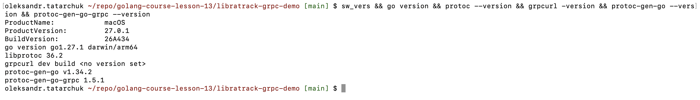 |
| S2 | `go test ./... -race -count=1` демо: три пакети з тестами зелені | `docs/demo/go-test.txt` | 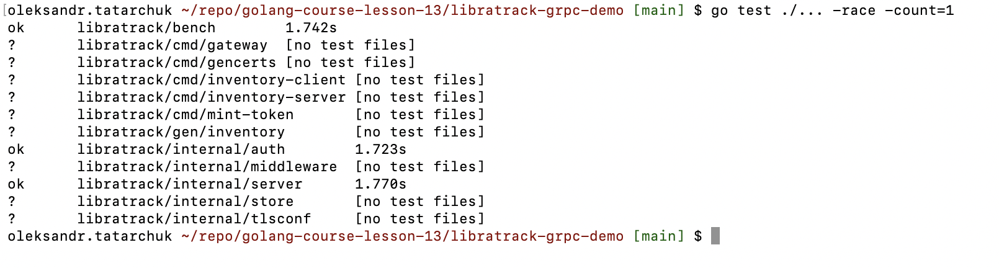 |
| S3 | швидкий старт: `client get copy-1` і `curl` через gateway | `docs/demo/quickstart.txt` | 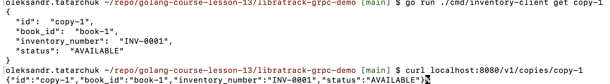 |
| S4 | унарні виклики: `NotFound`, `AlreadyExists`, grpcurl через server reflection | `docs/demo/unary.txt` | 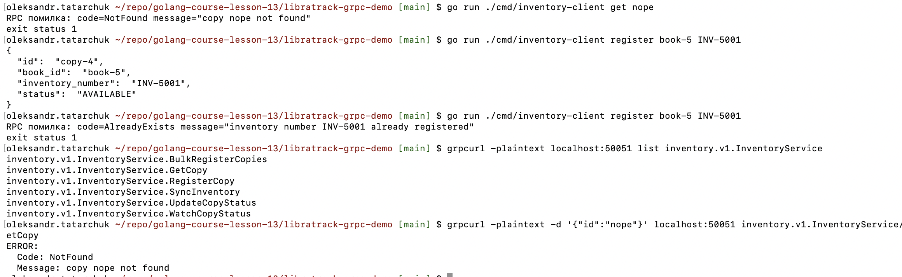 |
| S5 | серверний стрімінг: три оновлення й `io.EOF`, скасування через Ctrl+C | `docs/demo/server-stream.txt` | 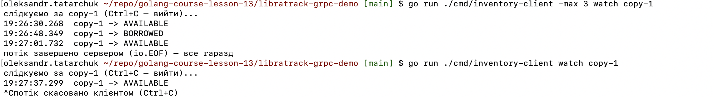 |
| S6 | клієнтський стрімінг (`bulk`: 5/0, повторно 0/5) і двонапрямлений (`sync`: `applied=true`/`false`) | `docs/demo/client-stream.txt`, `docs/demo/bidi.txt` | 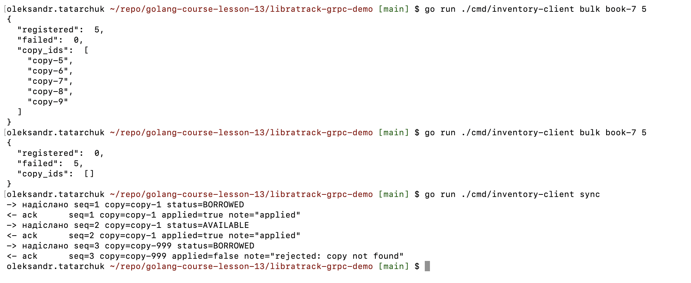 |
| S7 | REST через gateway: 200, 409, 400 і потік JSON-рядків `watch` | `docs/demo/gateway.txt` | 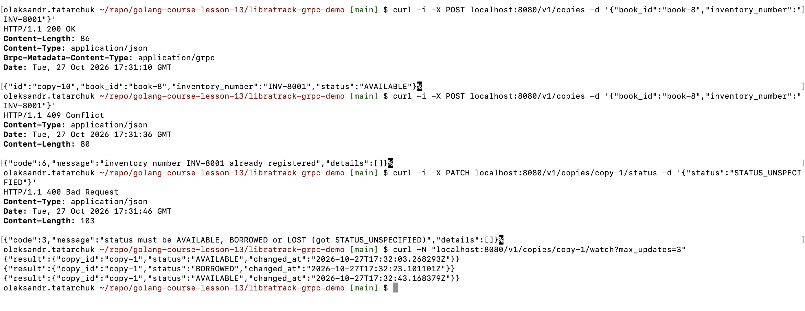 |
| S8 | JWT: `Unauthenticated`, `PermissionDenied` для reader, успіх для librarian, REST 401/200 | `docs/demo/auth.txt` | 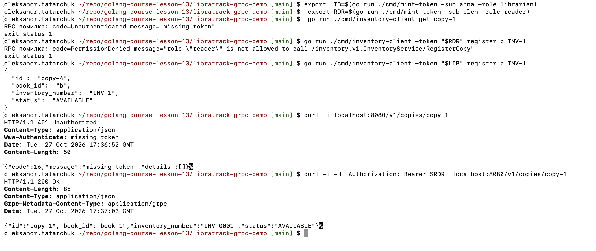 |
| S9 | mTLS: `gencerts` і чотири негативні сценарії (без TLS, без сертифіката, чужий CA, без токена) | `docs/demo/mtls.txt` | 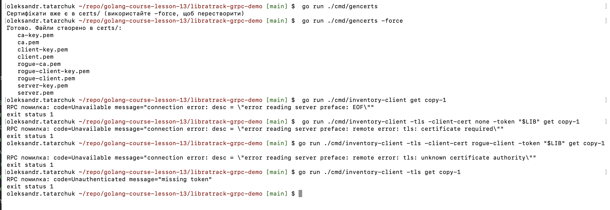 |
| S10 | тести стрімінгу (`-run Watch -v`), розмір повідомлень і бенчмарк | `docs/demo/tests.txt`, `docs/demo/bench.txt` | 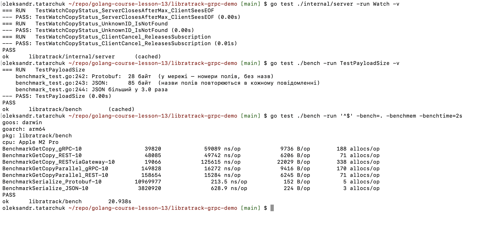 |
| S11 | `make smoke`: «ВСЕ ГАРАЗД» | `docs/demo/smoke.txt` | 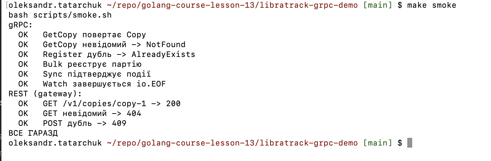 |
| S12 | `make proto`: відмінність лише у двох рядках із версією protoc, відкат | `docs/demo/proto-regen.txt` | 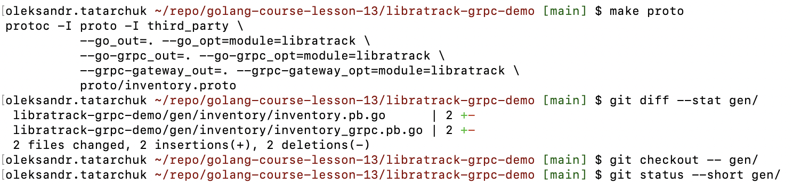 |
| S13 | власний сервіс: два `create` Go-клієнтом під час `watch` в іншому терміналі (події та `io.EOF` — у журналі) | `docs/albums/client.txt` | 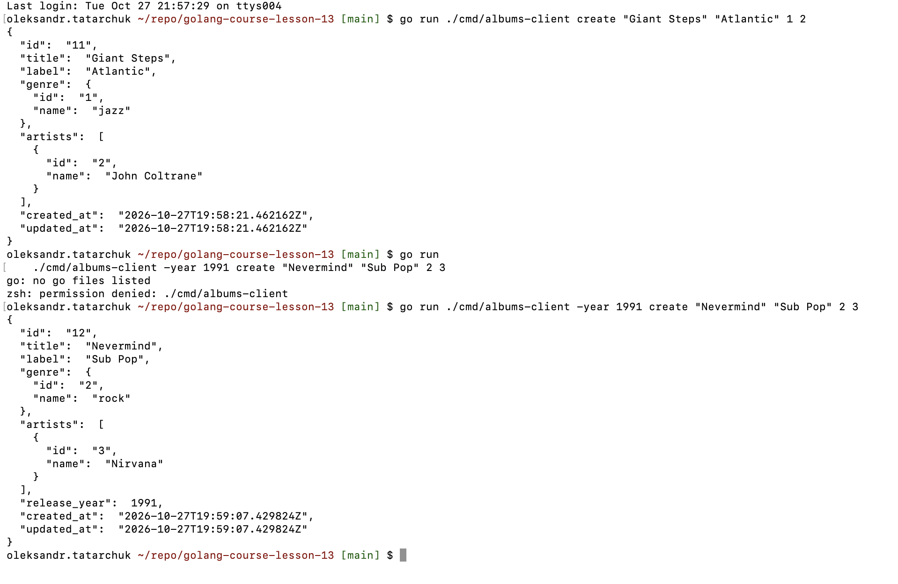 |
| S14 | власний сервіс: `make test` (покриття) і `make smoke` з перевірками стріму «ALL OK» | `docs/albums/tests-after.txt`, `docs/albums/smoke.txt` | 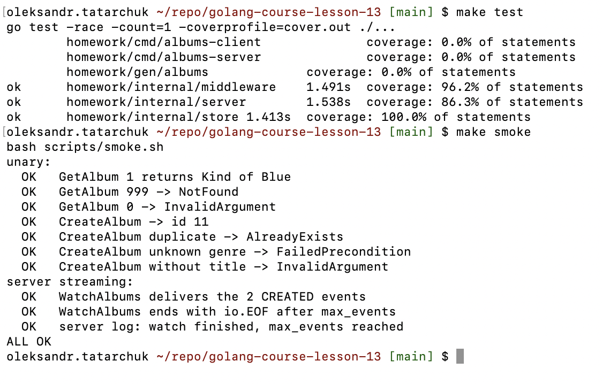 |

## CI

Робочий процес `lesson13-check.yml` запускається на кожен push і pull request і містить три завдання:

- `static`: обов'язкові файли на місці, `gofmt`, `go vet` і `go build`, `go mod tidy` без змін, лише ASCII у власному
  Go-коді, у документації та `prompts.txt` немає JWT-токенів, `.env` не закомічено, shell-скрипти проходять `bash -n`, контракт має
  пакет `albums.v1`, три rpc і рівно один `stream`, згенерований код актуальний (`make proto` у CI), обробники
  сервера повертають лише gRPC-статуси (слайд 46). Кожна перевірка
  потрапляє в підсумок запуску (Actions → run → Summary) як PASS/FAIL; крок падає наприкінці, якщо хоч одна
  перевірка не пройшла.
- `test`: власний модуль — `go vet`, тести з `-race` і профілем покриття `cover.out` (зберігається як артефакт запуску),
  `bash scripts/smoke.sh`.
- `demo`: демо з презентації в теці `libratrack-grpc-demo/` — `go vet`, `go mod tidy` без змін, тести з `-race`,
  `bash scripts/smoke.sh` (сервер + gateway + сценарії слайда 44) і перегенерація коду з `.proto` тими самими
  версіями плагінів (`make tools proto`; відмінність допускається лише в рядку з версією `protoc`).

Зелені прогони: [run 40538510618](https://github.com/tatarchuk/golang-course-lesson-13/actions/runs/40538510618) (демо, завдання `static` і `demo`)
і [run 40576869474](https://github.com/tatarchuk/golang-course-lesson-13/actions/runs/40576869474) (власний сервіс, усі три завдання).

## Lesson 13 Report: gRPC Microservices

Умова: [albums_lesson13_homework.md](albums_lesson13_homework.md) — оцінювання «[Tasks 13]» і слайди презентації
«Мікросервісна архітектура: gRPC замість REST». Це новий репозиторій без коду попередніх тем.

| Завдання (бали) | Що зроблено | Стан |
|---|---|---|
| 1. Запустити на власному ПК приклади з презентації (70) | курсовий демо-проєкт `libratrack-grpc-demo` на Mac без Docker і VM: збірка й тести, усі сценарії його README (розділи 3–6: унарні виклики й коди, три види стрімінгу, REST через grpc-gateway, JWT, mTLS, тести, бенчмарк, smoke, перегенерація коду) | готово: журнали в `docs/demo/`, скриншоти S1–S12 |
| 2. Сервер і клієнт на Go: 1 унарний і 1 стрімінговий RPC (+30) | `AlbumsService` (`albums.v1`): `GetAlbum` і `CreateAlbum` (унарні), `WatchAlbums` (серверний стрімінг); тести спершу, сервер, клієнт, smoke, CI | готово: журнали в `docs/albums/`, скриншоти S13–S14 |
| 3. SonarQube Cloud (обов'язково, бали не вказано) | не виконувалось: за рішенням автора цей пункт для поточного проходження необов'язковий | не виконано |

### Середовище

Усе працює безпосередньо на Mac ([docs/environment.txt](docs/environment.txt), скриншот [S1](docs/screenshots/s01-versions.png)):

| Компонент | Версія |
|---|---|
| macOS, процесор | 27.0.1 (26A434), Apple M2 Pro, arm64 |
| Go | 1.27.1 darwin/arm64 |
| protoc | libprotoc 36.2 (Homebrew; у заголовках згенерованих файлів — `v7.36.2`) |
| protoc-gen-go, protoc-gen-go-grpc, protoc-gen-grpc-gateway | v1.34.2, 1.5.1, v2.20.0 (версії з `Makefile` демо) |
| grpcurl | v1.9.4 (`go install`) |
| модуль демо `libratrack` | grpc v1.64.1, protobuf v1.34.2, grpc-gateway v2.20.0 (зафіксовано автором демо) |
| модуль `homework` | grpc v1.85.0, protobuf v1.36.12 (те, що дав `go get` 27.10.2026, [proto-gen.txt](docs/albums/proto-gen.txt)) |
| CI | GitHub Actions, образ `ubuntu-26.04`, protoc 3.21.12 з apt, Go за `go.mod` |

### Як відтворити

```bash
# Завдання 1: демо з презентації (далі — розділи 3–6 його README)
cd libratrack-grpc-demo && go mod tidy && go test ./... -race -count=1 && make smoke && cd ..
# Завдання 2: власний сервіс
make test && make smoke                       # тести з -race і покриттям, наскрізна перевірка
make server                                   # термінал 1 (:50051)
go run ./cmd/albums-client get 1              # термінал 2: унарні виклики...
go run ./cmd/albums-client -max 2 watch       # ...і серверний стрімінг (у третьому терміналі — два create)
```

### Завдання 1. Приклади з презентації на власному ПК (70)

Демо скопійовано без змін у [libratrack-grpc-demo/](libratrack-grpc-demo/); архів не містить `go.sum`, тож його
і чотири неявні залежності в `go.mod` додав `go mod tidy`. Кроки йдуть за розділами README демо. У журналах сесії
команди записано так, як їх набирали, разом із виводом і кодом завершення; лог «терміналу 1» (сервера) додано
в кінці кожного журналу повністю.

1. **Інструменти (слайди 15–16, 41).** `brew install protobuf`, плагіни через `go install` у версіях демо,
   `grpcurl`: таблиця середовища вище, [environment.txt](docs/environment.txt), [S1](docs/screenshots/s01-versions.png).
2. **Збірка й тести (слайд 44).** `go mod tidy` завантажив залежності (18 рядків `go.sum`), `gofmt -l` і `go vet`
   чисті, `go test ./... -race`: `bench`, `internal/auth`, `internal/server` — `ok`:
   [go-test.txt](docs/demo/go-test.txt), [S2](docs/screenshots/s02-demo-test.png).
3. **Швидкий старт (слайди 19, 28, 43).** Сервер пише `inventory server started addr=[::]:50051` і WARN «TLS
   вимкнено — відкритий текст лише для локальної розробки»; `client get copy-1` повертає `copy-1`, `book-1`,
   `INV-0001`, `AVAILABLE`; gateway на `:8080` віддає той самий об'єкт через `curl`:
   [quickstart.txt](docs/demo/quickstart.txt), [S3](docs/screenshots/s03-quickstart.png).
4. **Unary і коди (слайди 19, 41, 44, 45).** `get nope` → `code=NotFound message="copy nope not found"`;
   `register book-5 INV-5001` → `copy-4`, повтор → `code=AlreadyExists`; `grpcurl list` показує
   `inventory.v1.InventoryService` і два сервіси reflection, `list inventory.v1.InventoryService` — шість методів;
   `GetCopy` через grpcurl — той самий об'єкт у camelCase, невідомий id — `Code: NotFound`:
   [unary.txt](docs/demo/unary.txt), [S4](docs/screenshots/s04-unary-codes.png).
5. **Серверний стрімінг (слайди 20, 42, 46).** `-max 3 watch copy-1`: знімок `AVAILABLE`, після двох `set-status` —
   `BORROWED` і `AVAILABLE`, далі «потік завершено сервером (io.EOF)», у логу сервера `watch finished ...
   reason="max_updates reached" sent=3`; `watch` без `-max` і Ctrl+C: клієнт пише «потік скасовано клієнтом»,
   сервер — `reason="client gone / cancelled"` і `code=Canceled`; із `-simulate` — п'ять повідомлень за 7,7 с
   (зміна кожні 2 с): [server-stream.txt](docs/demo/server-stream.txt), [S5](docs/screenshots/s05-server-stream.png).
6. **Клієнтський і двонапрямлений стрімінг (слайди 21, 22).** `bulk book-7 5` → `registered: 5` (`copy-4`…`copy-8`),
   повтор → `failed: 5` і п'ять WARN «item rejected» у логу, сам виклик при цьому успішний; `sync` — три події і три
   підтвердження: `applied=true`, `true`, `false` (`rejected: copy not found` для `copy-999`):
   [client-stream.txt](docs/demo/client-stream.txt), [bidi.txt](docs/demo/bidi.txt),
   [S6](docs/screenshots/s06-client-bidi.png).
7. **REST через grpc-gateway (слайди 28, 43, 46).** `GET /v1/copies/copy-1` → 200 і ті самі дані, що й у `grpcurl`
   поруч; `nope` → 404 (`code: 5`); `POST` → `copy-4`, повтор → 409 (`code: 6`); `PATCH` → `LOST`;
   `STATUS_UNSPECIFIED` → 400 (`code: 3`); `curl -N .../watch?max_updates=3` — три JSON-рядки (`LOST`, `BORROWED`,
   `AVAILABLE`) після двох `PATCH` з іншого вікна: [gateway.txt](docs/demo/gateway.txt),
   [S7](docs/screenshots/s07-gateway.png).
8. **Токени (слайди 32–33).** Сервер із `-auth`: без токена — `Unauthenticated "missing token"`; `reader` читає,
   але `register` і стрімінговий `bulk` → `PermissionDenied "role \"reader\" is not allowed to call ..."`;
   `librarian` реєструє; протермінований токен (`-ttl=-1m`) → `Unauthenticated "invalid token"`;
   `grpcurl -H "authorization: Bearer ..."` — успіх; REST: 401 із `Www-Authenticate`, 200 з токеном, 403 для `POST`
   читача. Значення токенів у журналі замасковано (CI-guard забороняє JWT у `docs/`): [auth.txt](docs/demo/auth.txt),
   [S8](docs/screenshots/s08-token.png).
9. **mTLS (слайди 30–31).** `gencerts` створює дев'ять PEM-файлів у `certs/` (поза git); `-tls -auth` з довіреним
   сертифікатом і токеном — успіх; чотири негативні сценарії дають те, що описано в README демо: без `-tls` —
   `Unavailable ... error reading server preface: EOF`, `-client-cert none` — `tls: certificate required`,
   `rogue-client` — `tls: unknown certificate authority`, без токена — `Unauthenticated "missing token"` (mTLS
   пройдено, користувача немає); gateway `-tls` → 200; `grpcurl` з `-cacert`, `-cert`, `-key` — успіх; із
   `GRPC_GO_LOG_SEVERITY_LEVEL=info` сервер показує справжні причини: `client didn't provide a certificate` і
   `x509: certificate signed by unknown authority`: [mtls.txt](docs/demo/mtls.txt), [S9](docs/screenshots/s09-mtls.png).
10. **Тести й бенчмарк (слайди 44, 46, 47).** `-run Watch -v`: три тести стрімінгу (`io.EOF` після `max`,
    `NotFound`, звільнення підписки після скасування) — PASS; `TestPayloadSize`: Protobuf 28 байт, JSON 85 байт
    (3,0×); `-bench=. -benchtime=2s` на M2 Pro: gRPC 60,7 мкс, рукописний REST 49,5 мкс, REST через gateway
    125,9 мкс на виклик; паралельно 16,1 і 15,4 мкс; серіалізація Protobuf 215,6 нс проти JSON 637,7 нс. Порядок
    такий самий, як у README демо (Linux, 1 vCPU): для одного крихітного запиту на loopback рукописний REST
    найшвидший, gateway — найповільніший (два протоколи), Protobuf утричі компактніший і швидший у серіалізації;
    абсолютні числа на macOS вищі: [tests.txt](docs/demo/tests.txt), [bench.txt](docs/demo/bench.txt) (порівняння
    в кінці файлу), [S10](docs/screenshots/s10-tests-bench.png).
11. **Smoke (слайди 44, 46).** `make smoke`: дев'ять перевірок gRPC і REST — `OK`, «ВСЕ ГАРАЗД»:
    [smoke.txt](docs/demo/smoke.txt), [S11](docs/screenshots/s11-smoke.png).
12. **Перегенерація коду (слайди 15–16).** `make tools`, `make proto`: `git diff --stat gen/` — два файли по одному
    рядку (`protoc v7.36.2` замість `v3.21.12` у заголовку), сам код ідентичний; збірка й тести з перегенерованим
    кодом проходять; diff відкочено: [proto-regen.txt](docs/demo/proto-regen.txt), [S12](docs/screenshots/s12-proto-regen.png).

#### Що не спрацювало як написано

README демо попереджає, що запуск на macOS не перевірявся. Усі сценарії пройшли як написано; нижче — те, що
відрізнялося від очікуваного або потребувало пояснення.

| Де | Що сталося | Причина | Рішення |
|---|---|---|---|
| 1.11, `make smoke` у терміналі користувача | один прогін упав на рядку «Register дубль -> AlreadyExists» з `code=DeadlineExceeded` | у `bin/server.log` перший `register` → `OK`, а клієнт-дубль так і не підключився за свої 5 с (наступний запис у логу — `bulk` через 5 с): свіжий процес клієнта застряг до першого з'єднання. `grpc.NewClient("localhost:...")` резолвить ім'я DNS-резолвером grpc-go (разом із TXT-запитом), і один загублений UDP-пакет коштує 5 с таймауту резолвера Go; другий кандидат — діалог брандмауера macOS для щойно зібраного `bin/inventory-server` | повторний прогін — «ВСЕ ГАРАЗД», ще два — по ~3 с; DNS відповідає за 3–8 мс. Власний smoke-скрипт і тести ходять на `127.0.0.1`: IP-літерал обходить резолвер |
| 1.12, `make proto` | згенеровані файли відрізняються від закомічених | лише рядок заголовка з версією `protoc` (36.2 тут проти 3.21.12 в автора демо) | diff відкочено; у CI порівняння `git diff -I'^// .*protoc '`, яке пройшло на Ubuntu з protoc 3.21.12 |
| 1.5, Ctrl+C у `go run ./cmd/inventory-client watch` | після «потік скасовано клієнтом (Ctrl+C)» термінал показує `exit status 1` | це статус самої команди `go run`, яка теж отримала SIGINT; клієнт завершується з кодом 0, що показано запуском зібраного бінарника в кінці журналу | змінювати нічого не треба |
| журнали сесії | `curl` друкував індикатор прогресу | вивід сесії — не термінал | у журналах `curl -sS`; у терміналі користувача (скриншоти) команди як у README |

### Завдання 2. Власний сервер і клієнт на Go (+30)

**Контракт** [proto/albums.proto](proto/albums.proto): пакет `albums.v1` (версія в імені пакета, слайд 17),
кожне повідомлення і кожен RPC із коментарем; `release_year` і `notes` — `optional`, щоб «не задано» відрізнялося від
0 і порожнього рядка, як `null` у REST API; `AlbumEvent.Type` починається з `TYPE_UNSPECIFIED = 0`. Код згенеровано
тими самими плагінами, що й у демо, у `gen/albums/` (`make proto`, `--go_opt=module=homework`); CI перегенеровує
його і порівнює ([proto-gen.txt](docs/albums/proto-gen.txt)).

| RPC | Тип | Що робить |
|---|---|---|
| `GetAlbum(GetAlbumRequest) returns (Album)` | унарний | альбом за id, як `GET /albums/{id}` |
| `CreateAlbum(CreateAlbumRequest) returns (Album)` | унарний | валідація, перевірка посилань і дублів, збереження, як `POST /albums` |
| `WatchAlbums(WatchAlbumsRequest) returns (stream AlbumEvent)` | серверний стрімінг | живі події `CREATED`; `max_events > 0` — сервер закриває потік після N подій (чистий `io.EOF`), 0 — до скасування клієнтом |

**Коди статусу** (слайди 45–46) — відображення помилок сховища, як у HTTP-обробниках попередніх тем:

| Випадок | Код gRPC | Було в REST |
|---|---|---|
| `id < 1` у `GetAlbum`; помилка `Validate()` у `CreateAlbum` (повідомлення валідації в `message`) | `InvalidArgument` | 400, 422 |
| альбому з таким id немає | `NotFound` | 404 |
| невідомий `genre_id` або `artist_id` | `FailedPrecondition` | 422 |
| дубль пари `(title, label)` | `AlreadyExists` | 409 |
| усе інше | `Internal`, деталі лише в лозі сервера | 500 |

**Сховище** [internal/store/](internal/store/): демо-дані Теми 12 як Go-літерали (3 жанри, 6 виконавців,
10 альбомів із зв'язками: у «Kind of Blue» три виконавці, у «Waltz for Debby» немає року); `AlbumInput.Validate()`
з тими самими правилами і текстами (`title`, `label`, `genre_id`, `artist_ids` без повторів і нулів, `release_year`
0…9999); `Create` перевіряє посилання і дубль `(title, label)`, видає наступний id (перший новий — 11) і обидві
позначки часу, публікує подію; `Subscribe(ctx)` повертає буферизований канал (16 подій, повільний підписник
пропускає події і ніколи не блокує `Create`) і `cancel`, який безпечно викликати повторно; підписка знімається
і при завершенні контексту; `SubscriberCount()` — для перевірки витоку.

**Сервер** [internal/server/](internal/server/): `GetAlbum`, `CreateAlbum`, `WatchAlbums`; стрімінговий обробник
спершу підписується (жодна подія не губиться), працює зі `stream.Context()`, після `max_events` повертає `nil`,
при скасуванні клієнтом — `status.FromContextError`, і в обох випадках пише в лог `watch finished` з причиною;
підписка звільняється за будь-якого виходу (`defer cancel()`). У `server.go` немає `errors.New` і `fmt.Errorf`: це
перевіряють тест і CI. [internal/middleware/](internal/middleware/): recovery (panic → `Internal`) і logging (метод,
код, тривалість, адреса) для унарних і стрімінгових викликів. [cmd/albums-server/](cmd/albums-server/): `-addr`
(типово `:50051`), ланцюжок інтерсепторів, server reflection, WARN «TLS off: plaintext is for local development
only (slide 33)», м'яка зупинка з лімітом 5 с. [cmd/albums-client/](cmd/albums-client/): `get <id>`,
`create <title> <label> <genre_id> <artist_ids>` з прапорцями `-year` і `-notes`, `watch` з `-max N`; відповіді у
protojson (snake_case), помилки як `code=... message=...`, `io.EOF` як «stream closed by the server (io.EOF)»,
Ctrl+C скасовує потік. [scripts/smoke.sh](scripts/smoke.sh) збирає бінарники в `bin/`, піднімає сервер на
`127.0.0.1:50061` і проганяє сім унарних перевірок і три стрімінгові.

**Тести спершу.** [tests-before.txt](docs/albums/tests-before.txt): тести трьох пакетів написано до коду, прогін
червоний (кожен пакет не збирається через відсутні символи). [tests-after.txt](docs/albums/tests-after.txt): ті самі
35 тестів зелені з `-race` (сховище 20, інтерсептори 4, сервер 11); покриття `internal/store` 100 %,
`internal/server` 86,3 %, `internal/middleware` 96,2 % (загалом 30,0 %: у `cmd/` і згенерованому коді тестів немає);
`make smoke` — «ALL OK» (до появи бінарників той самий скрипт падав на збірці). Серверні тести працюють через
справжній `grpc.Server` на `127.0.0.1:0` з тими самими інтерсепторами, що й у бінарнику: «Kind of Blue» з жанром і
трьома виконавцями в порядку seed, `NotFound` для 999, `InvalidArgument` для 0, альбом 10 без `release_year`,
створення → id 11 і повторне читання, чотири повідомлення валідації, `FailedPrecondition`, `AlreadyExists`,
`WatchAlbums` з `max_events=2` — дві події `CREATED` у порядку створення й `io.EOF`, скасування клієнтом —
`Canceled` і `SubscriberCount()` знову 0, статична перевірка `server.go`.

**Запуск** (скриншоти [S13](docs/screenshots/s13-albums-run.png), [S14](docs/screenshots/s14-albums-test-smoke.png)):

- [grpcurl.txt](docs/albums/grpcurl.txt): `list`, `describe albums.v1.AlbumsService` (три RPC, один `stream`) і
  `describe albums.v1.Album`; `GetAlbum` 1 і 10, `NotFound` для 999, `InvalidArgument` для 0; `CreateAlbum` → id 11,
  дубль → `AlreadyExists`, жанр 99 → `FailedPrecondition`, без `title` і з повтором виконавця → `InvalidArgument`
  з обома повідомленнями; `WatchAlbums` з `max_events: 2` — дві події після двох `CreateAlbum` з іншого терміналу,
  після чого grpcurl завершується сам.
- [client.txt](docs/albums/client.txt): `get 1`, `get 10` (без `release_year`), `get 999`, `get 0`; `create` з
  `-year` і `-notes`, дубль, невідомий жанр, порожній `title`, рік 12345 → чотири різні коди з текстами валідації;
  `-max 2 watch` + два `create` з третього терміналу → дві події і «stream closed by the server (io.EOF)», у логу
  `reason="max_events reached" sent=2`; `watch` без ліміту і Ctrl+C → «stream cancelled by the client (Ctrl+C)», у
  логу `reason="client gone / cancelled"` і `code=Canceled`.
- [smoke.txt](docs/albums/smoke.txt): десять перевірок — «ALL OK», лог сервера з усіма кодами.

Дві відмінності JSON від REST API попередніх тем, обидві — властивості Protobuf: grpcurl друкує поля у camelCase
(`releaseYear`), а власний клієнт — у snake_case, як було в REST; не задане `optional`-поле у виводі відсутнє, а
не `null`.

### Завдання 3. SonarQube Cloud

Не виконувалось. Автор вирішив, що для цього проходження пункт необов'язковий; у репозиторії немає ні
`sonar-project.properties`, ні відповідного завдання CI, ні секретів. Умова в
[albums_lesson13_homework.md](albums_lesson13_homework.md) залишена як є — як опис того, що вимагав курс.

### Чеклісти з презентації

Слайд 44 (тестування збірки): демо (завдання 1) і власний сервіс (завдання 2).

| Сценарій | Демо | Власний сервіс |
|---|---|---|
| `grpcurl` з коректним ID повертає message | `GetCopy copy-1` → `Copy` ([unary.txt](docs/demo/unary.txt)) | `GetAlbum` 1 → `Album` ([grpcurl.txt](docs/albums/grpcurl.txt)) |
| `grpcurl` з невідомим ID → `codes.NotFound` | `Code: NotFound` для `nope` ([unary.txt](docs/demo/unary.txt)) | `Code: NotFound` для 999 ([grpcurl.txt](docs/albums/grpcurl.txt)) |
| стрімінговий виклик Go-клієнта: кілька оновлень, потім чистий `io.EOF` | три повідомлення і `io.EOF` ([server-stream.txt](docs/demo/server-stream.txt)) | дві події і `io.EOF` ([client.txt](docs/albums/client.txt)) |
| REST через grpc-gateway повертає ті самі дані у JSON | `grpcurl` і `curl` поруч ([gateway.txt](docs/demo/gateway.txt)) | REST-містка немає (поза умовою) |
| сервер без TLS лише локально | WARN «TLS вимкнено» ([quickstart.txt](docs/demo/quickstart.txt)); mTLS у [mtls.txt](docs/demo/mtls.txt) | WARN «TLS off: plaintext is for local development only» у лозі ([client.txt](docs/albums/client.txt)); TLS поза умовою |

Слайд 46 (перед завершенням):

- коректні gRPC-коди в разі збою, без `errors.New` і `fmt.Errorf` в обробниках: демо — `status.Errorf` у
  `internal/server/server.go` і коди в [unary.txt](docs/demo/unary.txt); власний сервіс — таблиця кодів вище, тест
  `TestServerHandlersUseStatusErrorsOnly` і перевірка CI;
- стрімінговий виклик звільняє ресурси при відключенні клієнта: демо — `reason="client gone / cancelled"` у
  [server-stream.txt](docs/demo/server-stream.txt) і тест `TestWatchCopyStatus_ClientCancel_ReleasesSubscription`
  у [tests.txt](docs/demo/tests.txt); власний сервіс — та сама причина в лозі ([client.txt](docs/albums/client.txt))
  і тест `TestWatchAlbumsClientCancelIsCanceledAndReleasesTheSubscription` (`SubscriberCount()` → 0);
- REST-місток повертає ті самі дані, що й нативний виклик: демо — [gateway.txt](docs/demo/gateway.txt); у власному
  сервісі містка немає;
- перевірено невідомий і некоректний ID: демо — `nope` → `NotFound`, 404 і 400 через gateway; власний сервіс —
  999 → `NotFound`, 0 → `InvalidArgument` у [grpcurl.txt](docs/albums/grpcurl.txt) і [client.txt](docs/albums/client.txt).

### Докази

- Середовище: [environment.txt](docs/environment.txt).
- Демо (завдання 1): [go-test.txt](docs/demo/go-test.txt), [quickstart.txt](docs/demo/quickstart.txt),
  [unary.txt](docs/demo/unary.txt), [server-stream.txt](docs/demo/server-stream.txt),
  [client-stream.txt](docs/demo/client-stream.txt), [bidi.txt](docs/demo/bidi.txt), [gateway.txt](docs/demo/gateway.txt),
  [auth.txt](docs/demo/auth.txt), [mtls.txt](docs/demo/mtls.txt), [tests.txt](docs/demo/tests.txt),
  [bench.txt](docs/demo/bench.txt), [smoke.txt](docs/demo/smoke.txt), [proto-regen.txt](docs/demo/proto-regen.txt).
- Власний сервіс (завдання 2): [proto-gen.txt](docs/albums/proto-gen.txt), [tests-before.txt](docs/albums/tests-before.txt),
  [tests-after.txt](docs/albums/tests-after.txt), [grpcurl.txt](docs/albums/grpcurl.txt), [client.txt](docs/albums/client.txt),
  [smoke.txt](docs/albums/smoke.txt).
- Скриншоти S1–S14: розділ [Скриншоти](#скриншоти).
- Промпти: [prompts.txt](prompts.txt).
